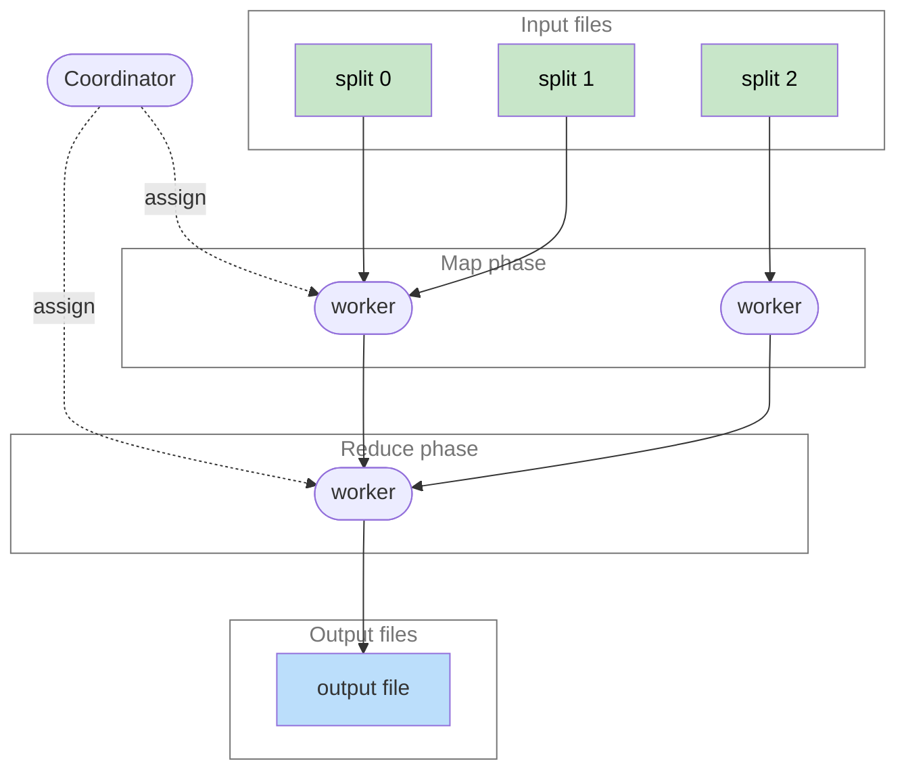
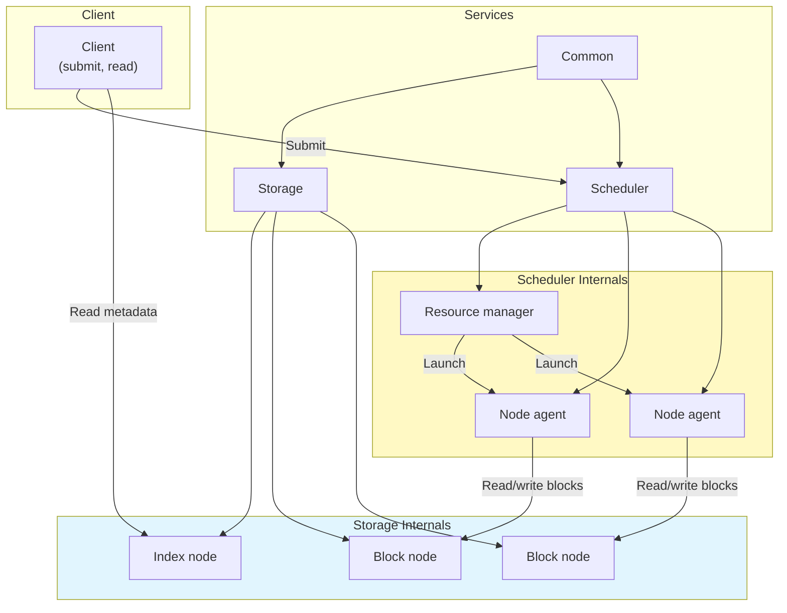

{/* Two mermaid blocks the author-fill tests read: subgraphs the author
cleared (fill:transparent), and one with a fill whose title Pele lifts out. */}

A batch job in phases.

The services a job runs on.

