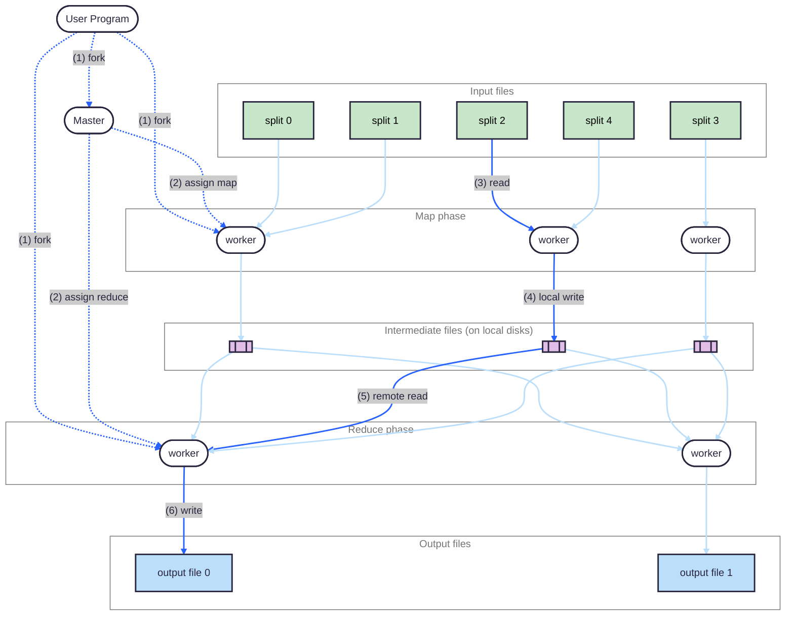
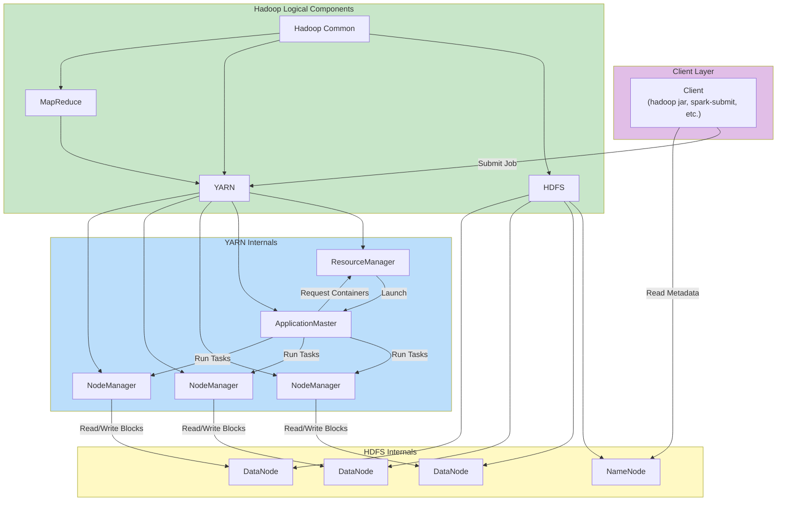

{/* Two mermaid blocks from the MapReduce note of the old notes site, which
the author-fill tests read: a subgraph the author cleared (fill:transparent)
and one with a fill whose title Pele lifts out. */}

The MapReduce execution overview.

Hadoop's components.

